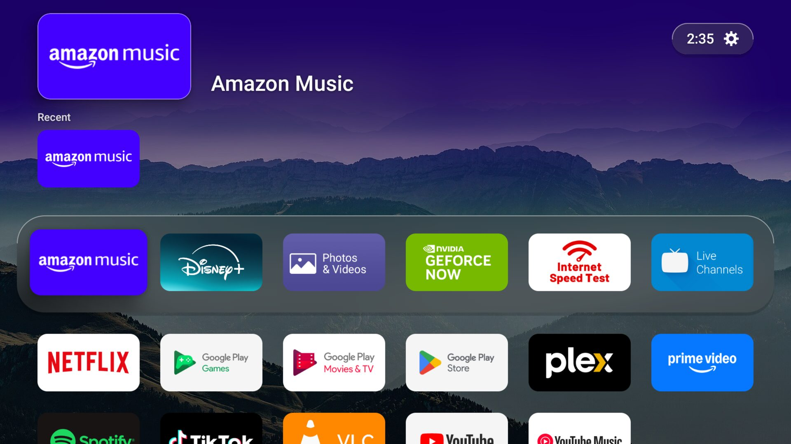
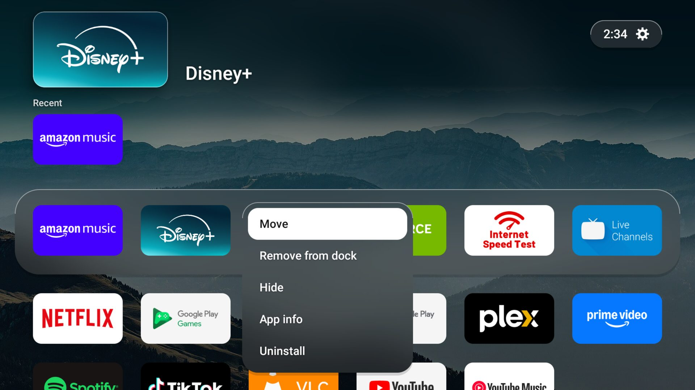
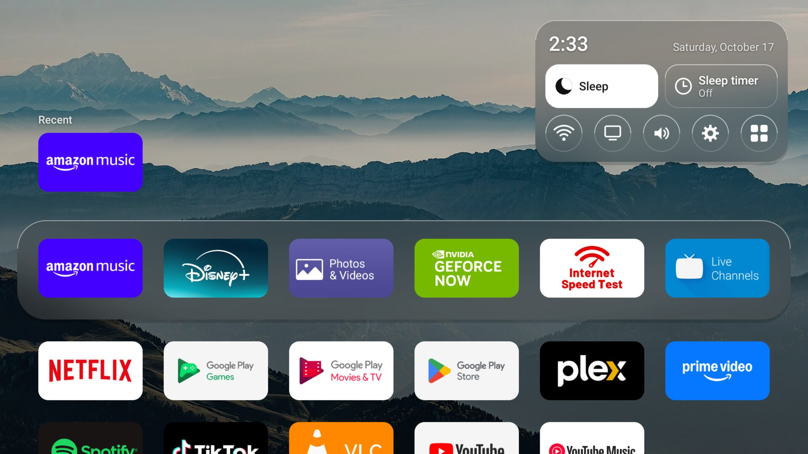
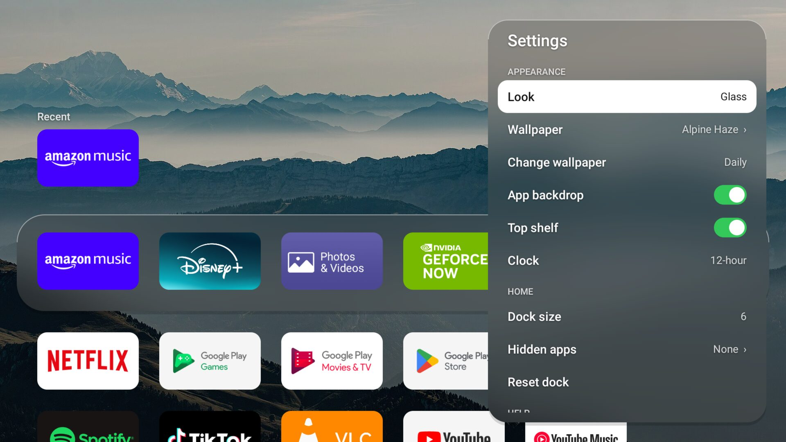
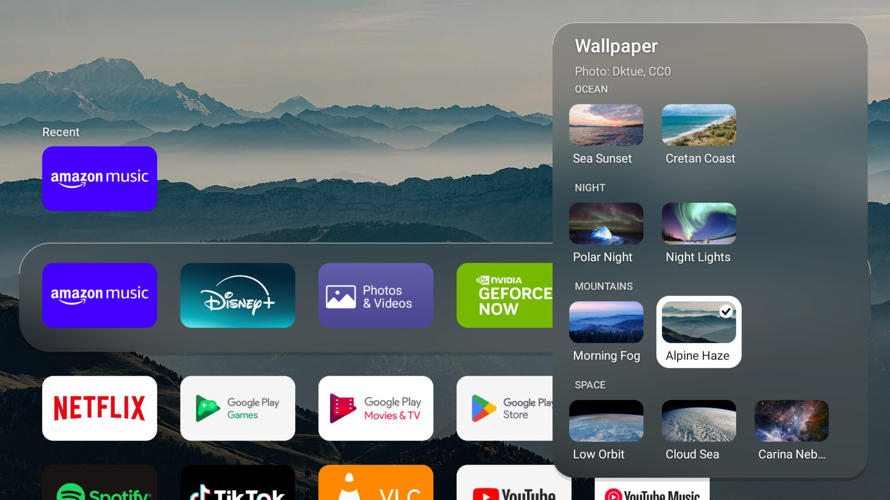
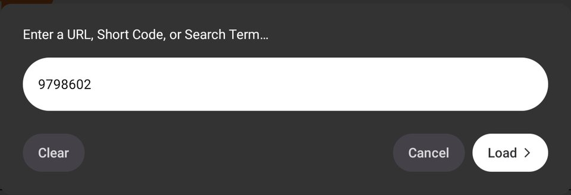
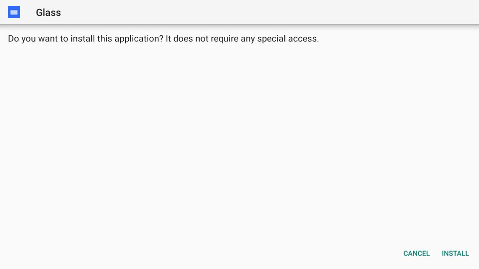
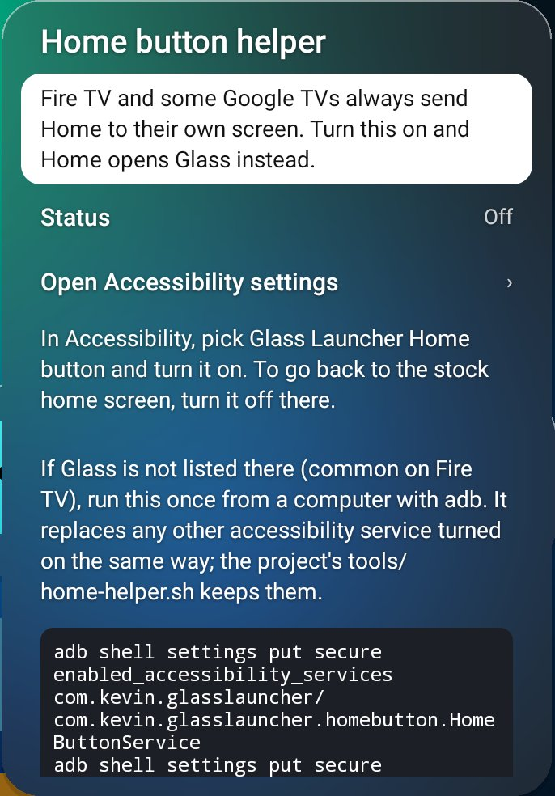

# Glass Launcher

An Android TV home screen with the look of Apple tvOS 26 "Liquid Glass": a frosted glass dock,
large banner tiles, springy focus motion, and a Quick Controls panel. Written in Kotlin with
Jetpack Compose (foundation only), built to be smoother and lighter than the stock launcher
without turning the effects off. No ads, no recommendations, no analytics.

Status: early (v0.2.0). Developed and measured on an NVIDIA Shield (Android 11); Google TV and
Fire TV devices are secondary targets.

| Home | Edit mode |
| --- | --- |
|  |  |
| **Quick Controls** | **Settings** |
|  |  |
| **Wallpapers** | |
|  | |

## Features

- **Glass dock** with up to six favorites as 16:9 banner tiles, and an **All apps** grid below it.
  Apps without a banner get their icon on a tile tinted from the icon's colour.
- **Top shelf** above the dock that follows the focused app.
- **Edit mode**: long-press Select on a dock tile, then move, unpin, hide, open App info or
  uninstall. Everything works with the D-pad alone.
- **Quick Controls** (Menu key, or the status pill): Sleep, Sleep timer, Wi-Fi, Inputs, and shortcuts
  to Display, Sound, Android Settings and Launcher Settings. The focused control turns solid white
  with dark text so it reads from across the room.
- **Look**: Glass, or Solid (opaque panels, like tvOS "Reduce Transparency").
- **Background**: a backdrop that follows the focused app, and/or rotating built-in wallpapers
  (hourly, daily, or off). Each is switchable in Settings.
- **Wallpapers**: soft colour fields plus free-licence photos grouped by category (Nature, Ocean,
  Night, Mountains, Space), one left/right row per category. Sources and licences:
  [docs/wallpaper-credits.md](docs/wallpaper-credits.md).
- Settings: look, wallpaper, background mode, dock size (4 to 6), hidden apps, 12/24-hour clock.
- **Device pages** in the same glass style: Wi-Fi (connection, signal, band, nearby networks),
  Bluetooth (paired devices), Sound (volume slider and mute, or your TV's volume over HDMI-CEC;
  audio formats), Display (resolution, refresh rate, HDR, supported modes), Storage and About.
  Android only lets apps read most of this, so joining networks, pairing and changing the
  resolution open Android's own page, one row away.
- **Backup**: export every setting (look, wallpaper, dock, hidden apps and the rest) to a JSON file
  and import it again, on this TV or another. Uses Android's file picker when the TV has one,
  otherwise `Download/GlassLauncher/`.
- Debug builds add a frame-time HUD for spotting jank by eye.

## Install on your TV (no computer needed)

Works on Android TV, Google TV and Fire TV with Android 9 or newer.

Want pictures of every step? See the [install guide](docs/install-guide.md) for Shield / Google TV
and Fire TV. Stuck? Paste the [AI help text](docs/ai-install-help.md) into ChatGPT, Claude or
Gemini and it walks you through each step.

1. Install **Downloader** by AFTVnews from the Google Play Store or the Amazon Appstore.
2. Let Downloader install apps:
   - Android TV / Google TV: Settings, Device Preferences, Security & restrictions, Unknown
     sources, Downloader (the menu names differ a little between TVs).
   - Fire TV: Settings, My Fire TV, Developer options, Install unknown apps, Downloader. If
     Developer options is missing, open Settings, My Fire TV, About and press Select on the
     device name seven times.
3. Open Downloader, select the address bar, enter the code **9798602** and press **Load**.
   A short page counts down about 6 seconds, then the download starts by itself.
4. Choose **Install**, then **Done**. Downloader offers to delete the downloaded file; that is
   safe, Glass stays installed.
5. Open **Glass** from your apps. Installing does not change the Home button yet; the first time
   Glass opens it offers **Show me how** for the next step.

| Enter the code, then Load | Install |
| --- | --- |
|  |  |

To update, use the Update card in Quick Controls when a new version is out, or Settings > About >
Check for updates (versions before 0.3.0: run the same steps again; the code always points at the
newest release). Your settings are kept. Without the code, the address is
`https://github.com/Kevsosmooth/glass-launcher/releases/latest/download/glass-launcher.apk`.

## Make it your Home screen

Most TVs send the Home button to their own launcher, so Glass needs one extra step. (Some
Android TV boxes ask "Select a Home app" the first time you press Home: pick Glass, Always, and
you are done.) Glass is then the real home screen, not an app on top of another one: the helper
just sends Home to it, and with a computer you can go further and switch the stock launcher off
(see Advanced).

**On the TV: Home button helper.** In Glass, open Quick Controls (Menu key, or the status pill),
then Launcher settings, Home button helper, Open Accessibility settings, and turn on **Glass
Launcher Home button** (on the Shield and Google TV it is under Device Preferences, Accessibility,
Services). Home then opens Glass; the TV's own screen may show for a moment first. The helper is an
accessibility service that only watches for the Home button and the stock home screen; it reads no
screen content. Turn it off in the same place to go back.



**Fire TV** does not list apps' accessibility services (checked on Fire OS 7.7), so there the
helper needs one command from a computer with adb (see below), once. The Home button helper
page shows the command and whether the helper is on. Fire TV's own screen may show for a moment
before Glass covers it.

## Advanced: adb, scripts and building

For these, turn on debugging: Settings, Device Preferences, About, press Build seven times; then
Developer options, Network debugging or USB debugging (Fire TV: Developer options, ADB debugging).

**Install over adb.**

```
adb connect <tv-ip>:5555
adb -s <tv-ip>:5555 install -r glass-launcher.apk     # from the Releases page
```

**Shield, Google TV and Android TV: disable the stock launcher.** The most complete switch, with
no helper needed (reversible, no root):

```
DEVICE=<tv-ip>:5555 tools/make-default.sh            # dry run: prints what it would do
DEVICE=<tv-ip>:5555 tools/make-default.sh --apply    # disables the stock launcher(s)
DEVICE=<tv-ip>:5555 tools/make-default.sh --undo     # brings the stock launcher back
```

The script refuses to disable anything unless Glass is installed first. If Projectivy Launcher is
present it asks before uninstalling it (`--remove-projectivy` answers yes; an uninstall cannot be
undone). Equivalent by hand:
`adb shell pm disable-user --user 0 com.google.android.tvlauncher` on Shield and Android TV, or
`com.google.android.apps.tv.launcherx` on Google TV (undo with `pm enable`).
If a TV ever ends up without a Home screen, `--undo` (or the `pm enable` line) fixes it.

**Fire TV: turn on the Home button helper.** Fire OS's launcher cannot be disabled without root:

```
DEVICE=<tv-ip>:5555 tools/home-helper.sh            # dry run
DEVICE=<tv-ip>:5555 tools/home-helper.sh --apply    # helper on (other services are kept)
DEVICE=<tv-ip>:5555 tools/home-helper.sh --undo     # helper off
DEVICE=<tv-ip>:5555 tools/test-home-helper.sh       # presses Home twice, checks Glass comes up
DEVICE=<tv-ip>:5555 tools/test-firetv.sh            # everything: install, screens, helper, restore
```

`test-firetv.sh` waits for "Allow USB debugging" on a first connection, stops if a video app is in
front, and writes `shots/firetv-<time>/summary.md` with one PASS/FAIL line per step. It turns the
helper off again at the end unless you pass `--keep-helper`.

**Build from source.** Needs JDK 17 and the Android SDK:

```
./gradlew :app:assembleRelease          # app/build/outputs/apk/release/app-release.apk
```

Release builds are signed with your debug key unless a `keystore.properties` (storeFile,
storePassword, keyAlias, keyPassword) sits in the repo root; it is git-ignored. Or use the
helpers, which can build on another machine over ssh and copy the APK to `out/`:

```
BUILD_HOST=my-build-box tools/build.sh release      # leave BUILD_HOST unset to build here
DEVICE=<tv-ip>:5555 tools/install.sh release
```

## Settings

Open Launcher Settings from Quick Controls. Look (Glass or Solid), wallpaper and wallpaper
rotation, the focused-app backdrop, the top shelf, dock size, hidden apps and the 12/24-hour clock.
The Device section lists Wi-Fi, Bluetooth, Sound, Display, Storage and About this TV with their
current values, plus Android Settings. Wi-Fi network names need the location permission (Android's
rule) and Location turned on.

## Privacy and network

Glass talks to three services, and nothing else:

- **GitHub**, once a day, to check for a new Glass release (and to download it when you choose
  Update).
- **Open-Meteo**, for the weather next to the clock. It gets a location rounded to about 1 km.
- **get.geojs.io**, to guess your city from your internet address when you have not picked one.

The weather location comes from the city you pick in Settings, or a guess from your internet
address. Glass reads the TV's own location only if you turn on "Use this TV's location" under
Weather location. Turn weather off and Glass makes no weather requests at all. No accounts,
analytics or ads.

## Performance budgets

Measured on the Shield with a release build, Glass look and all motion on:

| Metric | Budget |
| --- | --- |
| Frame time while moving through the dock or grid | p50 < 8 ms, p99 < 16.7 ms |
| Janky frames while navigating | < 1% |
| Idle RAM (PSS) on the home screen | < 70 MB |
| CPU while idle on the home screen | about 0% (nothing animates when nothing moves) |
| Cold start to first frame | < 500 ms |

Measure it yourself on a TV you own:

```
tools/build.sh release && tools/install.sh release
DEVICE=<tv-ip>:5555 tools/measure.sh my-tv       # writes reports/<date>-my-tv/summary.md
DEVICE=<tv-ip>:5555 tools/bench.sh               # macrobenchmarks (startup, frame timing)
```

`measure.sh` compares frame times, jank, RAM and idle CPU against the table above and exits
non-zero when a budget is missed.

Latest Shield run (v0.1.0, warm, second run after install): frame times and idle CPU are within
budget (dock p50 7.8 ms / p99 15.9 ms, grid p50 6.6 ms / p99 10.2 ms, idle CPU 0%). Two budgets
are still missed: slow dock navigation had 1.5% janky frames (2 of 120), and idle RAM is about
105 MB PSS, of which about 49 MB is GPU memory for the wallpaper and glass layers. Cold start
has not been measured yet. See [docs/testing.md](docs/testing.md) for the full test session.

## Contributing

Issues and pull requests are welcome.

- Keep files small and focused: components under 400 lines, other modules under 500, functions under 80.
- Pure logic gets JVM unit tests (JUnit 4). Run `./gradlew :app:testDebugUnitTest`, and for the
  scripts: `tools/test_scripts.sh`, `python3 tools/test_check_layout.py`,
  `python3 tools/test_summarize_report.py`.
- Everything must work with the D-pad alone; motion uses springs from `Motion.kt`.
- Do not commit secrets, device serials or personal IP addresses; scripts take the device from
  `DEVICE` or `-d`.

## Feedback

Bugs, ideas and device reports (model, Android version, what looked wrong) go in
[Issues](../../issues). A screenshot from `tools/screenshots.sh` helps for layout problems.

## License

[MIT](LICENSE). Copyright (c) 2026 Kevin Suriel.
