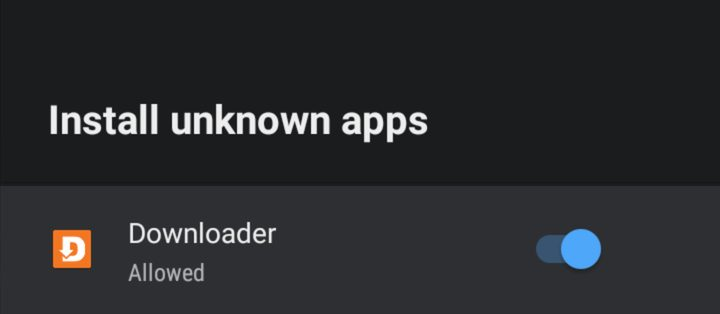
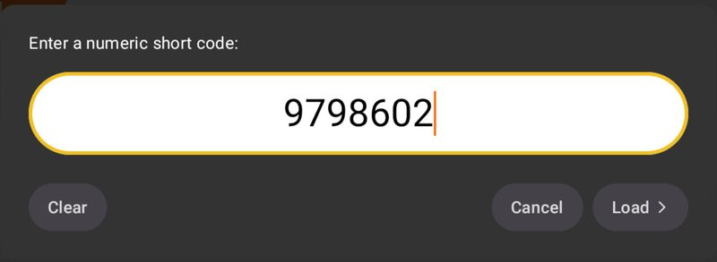
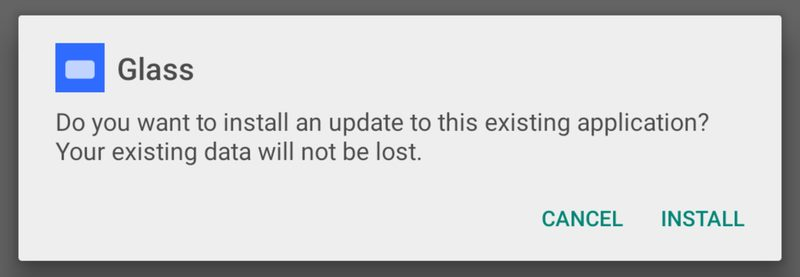
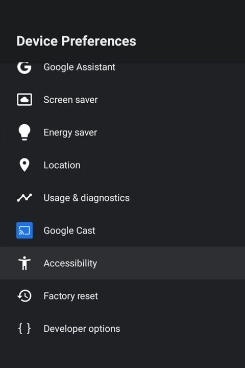
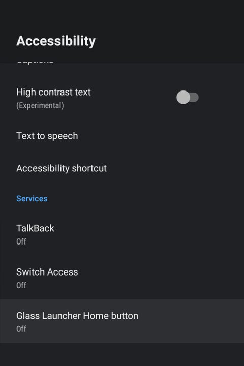
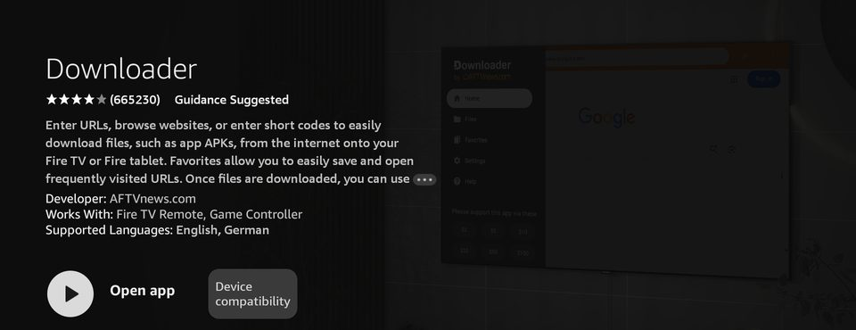
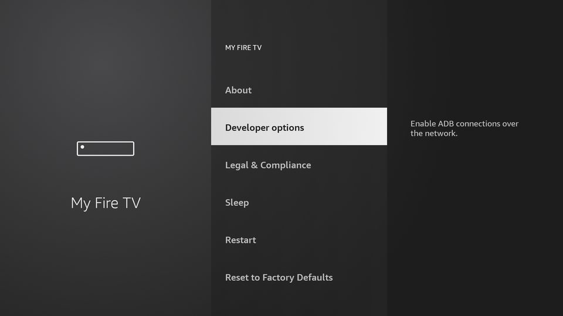
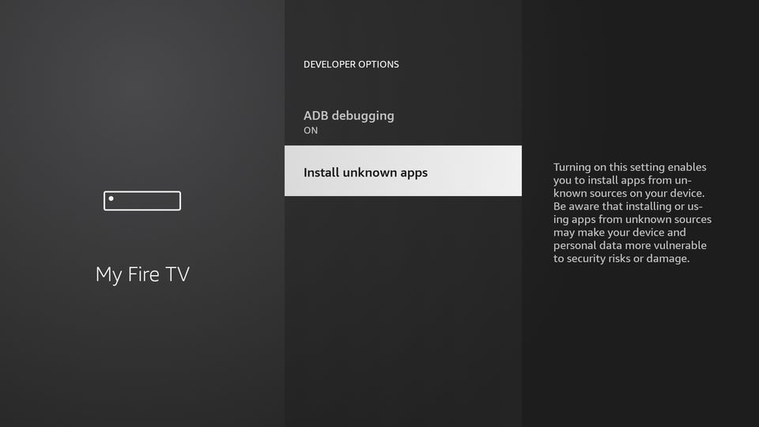
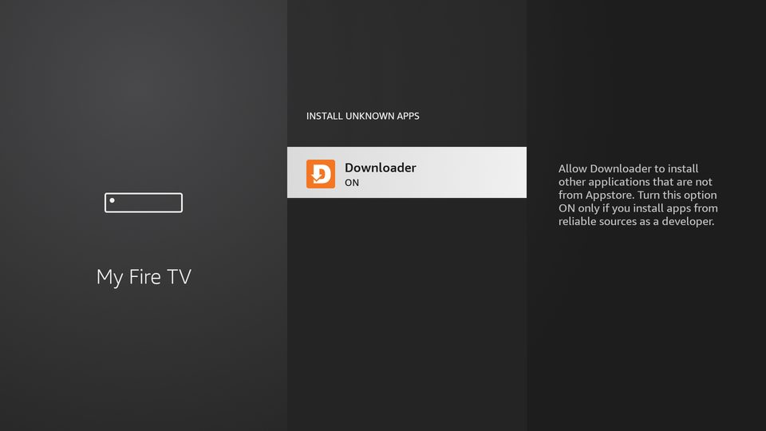

# Install guide with pictures

Every step of installing Glass Launcher from the TV itself, with no computer. Pictures are from
an NVIDIA Shield (Android TV 11) and a Fire TV Stick (Fire OS 7). Menu names can differ a little
on other TVs.

- [Android TV and Google TV (Shield, Chromecast, Sony, TCL and others)](#android-tv-and-google-tv)
- [Fire TV](#fire-tv)
- [Updating](#updating)

Stuck? Paste the [AI help text](ai-install-help.md) into any AI assistant and it walks you
through each step.

## Android TV and Google TV

### 1. Get Downloader

Search the Google Play Store for **Downloader** by AFTVnews and install it.

### 2. Let Downloader install apps

Settings, Device Preferences, Security & restrictions, Unknown sources, then turn on
**Downloader**. On Google TV it is Settings, Apps, Security & restrictions, Unknown sources; if
the switch is grayed out, turn on Developer options first (Settings, System, About, press
Android TV OS build seven times). Newer Google TV software may skip the menu and ask when
Downloader first installs something: choose Settings and turn on Allow from this source.

### 3. Enter the code

Open Downloader, press the **#** button at the top (or select the address bar), type
**9798602** and choose **Load**. A short page counts down about 6 seconds, then the download
starts by itself.

### 4. Install

Choose **Install**. If Glass is already installed, Android asks to install an update instead;
your settings are kept. Afterwards Downloader offers to delete the downloaded file: that is
safe, Glass stays installed. Installing does not change the Home button yet: the first time Glass
opens it offers **Show me how** for step 5.

### 5. Make Glass your Home screen

In Glass, open Quick Controls (Menu key, or select the clock), then Launcher settings, Home
button helper, Open Accessibility settings. If Settings opens on its main page, go to Device
Preferences, Accessibility. Under Services, turn on **Glass Launcher Home button**. The Home
button now opens Glass. Turn it off in the same place to go back to the stock home screen.

| Device Preferences | Accessibility, Services |
| --- | --- |
|  |  |

## Fire TV

### 1. Get Downloader

Search the Appstore for **Downloader** (say "Downloader" to Alexa, or use Find, Search) and
choose Get.

### 2. Let Downloader install apps

Settings, My Fire TV, Developer options.

If Developer options is missing: Settings, My Fire TV, About, then press Select on the device
name seven times. Go back and it is there.

Then Install unknown apps, and turn on **Downloader**.

| Developer options | Install unknown apps |
| --- | --- |
|  |  |

### 3. Enter the code and install

Open Downloader, select the address bar, type **9798602** and choose **Load**. After the short
countdown and download, choose **Install**, then **Done**. Deleting the downloaded file
afterwards is safe.

| Enter the code | Install |
| --- | --- |
|  |  |

### 4. Home screen

Open Glass from Your Apps & Channels. Fire OS does not show apps' accessibility services in its
Accessibility menu, so on Fire TV the Home button helper needs one command from a computer with
adb, once: see [Advanced in the README](../README.md#advanced-adb-scripts-and-building). The
helper page in Glass (Launcher settings, Home button helper) shows the command and whether it
is on.

## Updating

Run the same steps with the same code: it always points at the newest release, and your
settings are kept.
